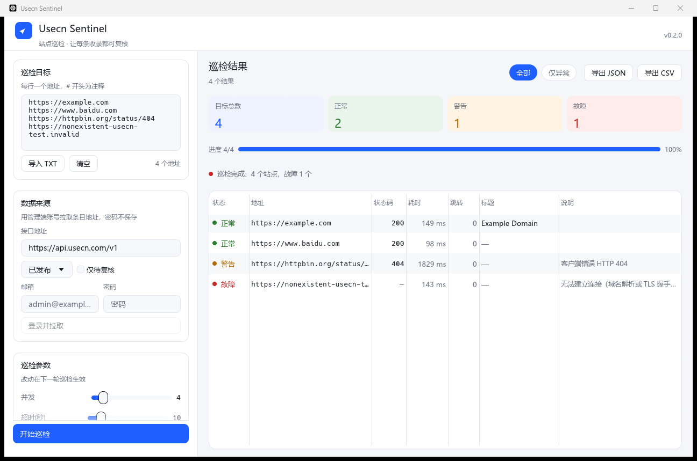

# Usecn Sentinel

[](https://github.com/shingle-coder/usecn-sentinel/releases)
[](https://github.com/shingle-coder/usecn-sentinel/releases)
[](https://github.com/shingle-coder/usecn-sentinel/releases)


面向 AI 资源目录运营的站点巡检桌面工具：批量检测收录站点的可达性、跳转链、页面标题与描述，输出可归档的 JSON / CSV 报告。

本仓库只发布 Windows 构建产物，源码在独立工程中维护。



## 下载

最新版本：[Usecn Sentinel 0.2.0](https://github.com/shingle-coder/usecn-sentinel/releases/tag/desktop-v0.2.0)

| 文件 | 说明 |
|---|---|
| [UsecnSentinel-Setup-0.2.0.exe](https://github.com/shingle-coder/usecn-sentinel/releases/download/desktop-v0.2.0/UsecnSentinel-Setup-0.2.0.exe) | NSIS 安装包，用户级安装，无需管理员权限 |
| [UsecnSentinel-0.2.0-windows-x64.zip](https://github.com/shingle-coder/usecn-sentinel/releases/download/desktop-v0.2.0/UsecnSentinel-0.2.0-windows-x64.zip) | 免安装版，解压后双击 `UsecnSentinel.exe` |
| [SHA256SUMS.txt](https://github.com/shingle-coder/usecn-sentinel/releases/download/desktop-v0.2.0/SHA256SUMS.txt) | 上述两个文件的 SHA-256 |

> **未做代码签名**：Windows 可能提示「未知发布者」，请先核对 SHA-256 再运行。

## 功能

- 从管理接口按状态与「仅待复核」筛选，分页拉取条目地址（只读）
- 1–32 并发巡检，逐跳跟随重定向，单请求超时 3–60 秒
- 三档判定：2xx 正常；3xx 未落到最终页与 4xx 警告；5xx、超时、连接失败故障
- 双栏界面、浅色/深色跟随系统、四块统计卡与自适应结果表
- JSON 报告与带 UTF-8 BOM 的 CSV 导出
- 本地保存并发、超时、跳转上限、接口地址与目标清单

## 使用流程

1. 在左侧「巡检目标」粘贴站点地址，或展开「数据来源」用管理端账号拉取条目
2. 按需调整并发、超时与最大跳转
3. 点击底部「开始巡检」，结果按正常 / 警告 / 故障三档展示
4. 完成后导出 JSON 或 CSV，或按「仅异常」筛选逐条复核

## 运行要求

- Windows 10 1809+ / Windows 11（x64）
- 配置目录：`%APPDATA%\usecn-sentinel\settings.json`

## 校验

```powershell
Get-FileHash .\UsecnSentinel-Setup-0.2.0.exe -Algorithm SHA256
```

输出应与 `SHA256SUMS.txt` 中对应行一致。

## 反馈

问题与建议请提交到 [Issues](https://github.com/shingle-coder/usecn-sentinel/issues)。

## 许可

MIT。
